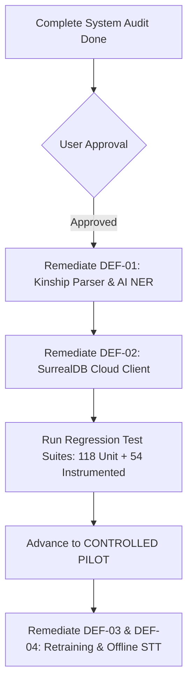

# KHATAWAS — PRIORITIZED REMEDIATION PLAN

**Target Release**: Controlled Pilot Readiness  
**Audit Reference**: `COMPLETE_SYSTEM_AUDIT_REPORT.md`  
**Current Gate**: `INTERNAL TESTING ONLY` $\rightarrow$ Target: `CONTROLLED PILOT`  
**Status**: Awaiting Explicit User Approval Before Implementation  

---

## TIER 1: CRITICAL PILOT BLOCKERS (P1)

### Item 1: Resolve Family Relationship False Merges in `LedgerParser.kt` (DEF-01)
- **Impact**: In a financial ledger, merging accounts of distinct family members (e.g. attributing *"Ravi ke papa ka udhaar"* to *"Ravi"*) corrupts customer balances and causes merchant disputes.
- **Root Cause**: `extractCustomerName()` in `app/src/main/java/com/khatawas/logic/LedgerParser.kt` halts at the first particle (`ka/ke/ki`) and returns the preceding word, ignoring following kinship nouns (`papa`, `pitaji`, `mummy`, `bhai`, `chacha`, `dada`, etc.).
- **Proposed Technical Solution**:
  1. Add a comprehensive Kinship Lexicon (`KINSHIP_NOUNS`) in both Latin Hinglish (`papa`, `pitaji`, `pita`, `mummy`, `mataji`, `bhai`, `chachu`, `chacha`, `beta`, `didi`, `bhabhi`) and Devanagari (`पापा`, `पिताजी`, `पिता`, `मम्मी`, `माताजी`, `भाई`, `चाचा`, `बेटा`, `दीदी`).
  2. When a particle (`ke`, `ki`, `के`, `की`) follows a candidate name, check if the subsequent token is a kinship noun. If so, compound the customer identity (e.g., `"Ravi ke papa"`, `"Ravi ki mummy"`).
  3. Update `ShadowModePipeline.kt` to prioritize the AI Student Model's BIO token NER boundary when resolving customer entities.
- **Affected Files**:
  - `app/src/main/java/com/khatawas/logic/LedgerParser.kt`
  - `app/src/main/java/com/khatawas/ai/ShadowModePipeline.kt`
  - `app/src/test/java/com/khatawas/logic/LedgerParserTest.kt`
- **Verification Criteria**:
  - All 10 mandatory relationship audit cases pass with 0% false merge rate between base customer and kin.

---

### Item 2: Integrate Production SurrealDB Cloud Client (DEF-02)
- **Impact**: Current cloud sync relies on an in-memory dictionary mock (`SurrealCloudStore`). Any restart of the FastAPI container or process drops all cloud backup records, leading to apparent cloud data loss.
- **Root Cause**: `backend/requirements.txt` lacks `surrealdb` SDK; `backend/app/surreal_client.py` uses simulated dict storage.
- **Proposed Technical Solution**:
  1. Add `surrealdb>=0.3.2` to `backend/requirements.txt`.
  2. Implement a production `SurrealDBClient` connecting via WebSocket (`wss://<surreal-endpoint>/rpc`) with user/namespace/database credentials configured via environment variables (`SURREAL_URL`, `SURREAL_USER`, `SURREAL_PASS`, `SURREAL_NS`, `SURREAL_DB`).
  3. Define schema migration scripts creating SurrealDB tables:
     - `DEFINE TABLE shop SCHEMAFULL;`
     - `DEFINE TABLE customer SCHEMAFULL;`
     - `DEFINE TABLE transaction SCHEMAFULL;`
     - `DEFINE TABLE owes SCHEMAFULL;`
     - `DEFINE TABLE paid SCHEMAFULL;`
     - `DEFINE TABLE event_projection SCHEMAFULL;`
  4. Retain fallback to local mock only when running in explicit offline test mode (`ENVIRONMENT=test`).
- **Affected Files**:
  - `backend/requirements.txt`
  - `backend/app/surreal_client.py`
  - `backend/app/config.py`
  - `backend/tests/test_api.py`
- **Verification Criteria**:
  - End-to-end sync writes to a live SurrealDB Cloud database; data persists across container restarts.

---

## TIER 2: HIGH-VALUE ENHANCEMENTS (P2)

### Item 3: Augment Synthetic Dataset & Retrain Student Model for Conversational Fillers (DEF-03)
- **Impact**: Conversational phrases with non-standard filler pronouns (e.g., *"Ravi ke papa ne mujhe 500 diye"*, *"alag hisaab"*) trigger the `ILLEGAL` intent because `"mujhe"` and `"alag"` were sparse in the training dataset.
- **Proposed Technical Solution**:
  1. Add conversational variations with dative/accusative pronouns (`mujhe`, `hamein`, `hume`, `apne ko`) and ledger idioms (`alag hisaab`, `pura hisaab`, `chutta`) into `ai-engine/scripts/generate_synthetic_dataset.py`.
  2. Retrain `CompactMultiTaskStudent` on the local RTX 5050 GPU for 5 epochs.
  3. Re-export ONNX FP32 and INT8 models to `ai-engine/exports/` and update `app/src/main/assets/models/`.
- **Affected Files**:
  - `ai-engine/scripts/generate_synthetic_dataset.py`
  - `ai-engine/scripts/train_student.py`
  - `app/src/main/assets/models/student_model_int8.onnx`

---

### Item 4: Offline On-Device STT Fallback (DEF-04)
- **Impact**: If network connectivity fails, voice recording cannot be transcribed because Gnani STT requires an active internet connection.
- **Proposed Technical Solution**:
  1. Integrate an on-device lightweight acoustic model (e.g. Sherpa-ONNX or whisper-tiny.tflite) for offline transcription fallback.
  2. Implement an automatic network connectivity monitor in `ChatbotVoiceAssistant.kt` that routes audio locally when offline.
- **Affected Files**:
  - `app/src/main/java/com/khatawas/ai/ChatbotVoiceAssistant.kt`
  - `app/src/main/java/com/khatawas/audio/AudioPipeline.kt`

---

## TIER 3: POLISH & TOOLING (P3)

### Item 5: Host Windows Toolchain Configuration (DEF-05)
- **Impact**: Running `cargo test` natively on Windows requires MSVC C++ build tools (`link.exe`).
- **Proposed Technical Solution**:
  - Add `.cargo/config.toml` configuring GNU toolchain or documenting cross-compilation with Android NDK.

### Item 6: Smooth Decryption & Masking Cross-Dissolve Animations (DEF-06)
- **Impact**: When unlocking/locking the app, numbers jump between `###XXX` and decrypted amounts instantaneously.
- **Proposed Technical Solution**:
  - Implement a 150ms alpha cross-fade animation in `TransactionAdapter.kt` and `MainActivity.kt` during state transitions.

---

## EXECUTION SEQUENCING & GATING

*Note: In accordance with audit protocols, no production source code has been altered. Implementation will commence upon user review and approval of this plan.*
