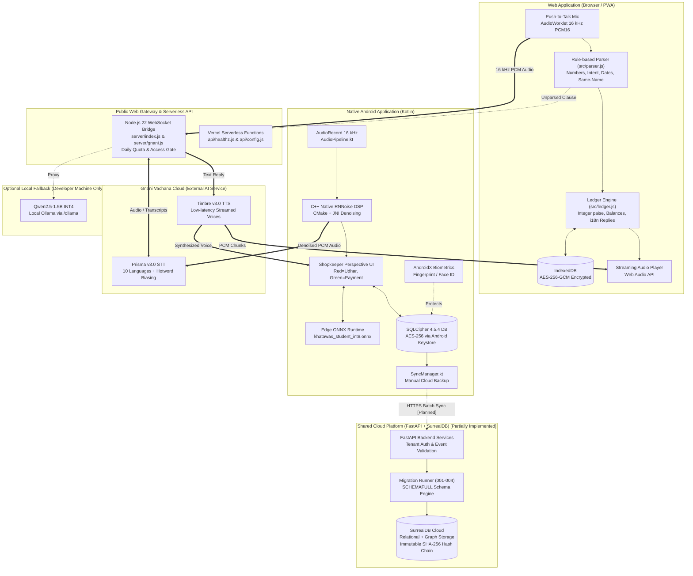

# KHATABOOK — The Voice Ledger for Kirana Stores

<p align="center">
  
</p>

<p align="center">
  <strong>Speak once. The khata is updated. No typing, no tapping, no stopping the sale.</strong>
</p>

<p align="center">
  <a href="https://khatawas.vercel.app"></a>
  <a href="https://khatawas.onrender.com/"></a>
  <a href="https://github.com/callmetechnophile/khatabook"></a>
  <a href="https://github.com/TheShreyanshiDwivedi/khatawas"></a>
  <a href="LICENSE"></a>
</p>

---

## Navigation & Repository Index

- [A. Project Identity](#a-project-identity)
- [B. Introduction](#b-introduction)
- [C. Core Features & Availability Matrix](#c-core-features--availability-matrix)
- [D. System Architecture](#d-system-architecture)
- [E. Web Application Architecture](#e-web-application-architecture)
- [F. Android Application Architecture](#f-android-application-architecture)
- [G. Shared Cloud Platform & SurrealDB](#g-shared-cloud-platform--surrealdb)
- [H. Financial & Ledger Architecture](#h-financial--ledger-architecture)
- [I. AI & Voice Intelligence](#i-ai--voice-intelligence)
- [J. Supported Languages](#j-supported-languages)
- [K. Data Security & Privacy](#k-data-security--privacy)
- [L. Technology Stack](#l-technology-stack)
- [M. Installation & Development Setup](#m-installation--development-setup)
- [N. Deployment Architecture](#n-deployment-architecture)
- [O. API Documentation](#o-api-documentation)
- [P. Project Directory Structure](#p-project-directory-structure)
- [Q. Testing & Validation](#q-testing--validation)
- [R. Current Status & Roadmap](#r-current-status--roadmap)
- [S. Contributing](#s-contributing)
- [T. License & Acknowledgements](#t-license--acknowledgements)
- [U. Contact & Project Links](#u-contact--project-links)

---

## A. Project Identity

- **Product Name:** KHATAWAS (खातावास)
- **Tagline:** A Voice-First Digital Ledger for Indian Shopkeepers.
- **Brand Identity:** Unified master brand artwork shared identically across Android launcher, web favicon, and product headers ([`brand/BRAND_IDENTITY_GUIDELINES.md`](brand/BRAND_IDENTITY_GUIDELINES.md)).
- **Target Audience:** Over 12–15 million small Indian retail store owners (*Kirana stores*, vegetable vendors, neighborhood chemists, milk dairies, and rural merchants) who extend informal customer credit (*udhaar*).
- **Core Repositories & Deployments:**
  - **Android & Monorepo Repository:** [https://github.com/callmetechnophile/khatabook](https://github.com/callmetechnophile/khatabook)
  - **Web Application Repository:** [https://github.com/TheShreyanshiDwivedi/khatawas](https://github.com/TheShreyanshiDwivedi/khatawas)
  - **Production Vercel Deployment:** [https://khatawas.vercel.app](https://khatawas.vercel.app)
  - **Render Docker Deployment:** [https://khatawas.onrender.com/](https://khatawas.onrender.com/)

---

## B. Introduction

### The Everyday Problem
In small Indian neighborhood stores, informal credit (*udhaar*) is the lifeblood of customer loyalty. Over 70% of transactions during peak morning and evening hours involve regular customers purchasing daily staples on credit to settle at the end of the week or month.

Historically, shopkeepers maintain these accounts in paper ledgers (*khata bahi*). Paper ledgers suffer from critical operational liabilities:
1. **Physical Loss & Wear:** Registers get stained, torn, misplaced, or destroyed by rain or fire.
2. **Checkout Friction:** Writing down names and calculating running balances while serving a queue of five impatient customers is stressful and error-prone.
3. **App Adoption Failure:** Conventional digital ledger apps require searching, tapping, and typing customer names on virtual keyboards with wet, dusted, or flour-covered hands. Consequently, shopkeepers abandon them during peak hours.

### The KHATAWAS Solution
KHATAWAS replaces manual typing with natural, hands-free voice interaction:
- A shopkeeper holds a single push-to-talk button, speaks in their natural mother tongue or code-mixed Hinglish (e.g., *"Ramesh ka teen sau udhaar, kal do sau diya tha"*), and releases the button.
- The system transcribes the speech, deterministically extracts the customer names, amounts, relative dates, and transaction types, books the entries into an encrypted ledger, and speaks back a confirmation in under a second.

### Two Clients, One Product Ecosystem
- **Web Application (`khatawas.vercel.app`):** Zero-install, browser-based progressive web application designed for laptops, tablets, and mobile browsers. Operates client-side with Web Audio worklets, WebCrypto AES-256-GCM in IndexedDB, and WebSocket streaming. Features an Apple HIG-inspired, story-driven introductory product showcase.
- **Android Application (`com.khatawas`):** High-performance, offline-first native Android app built with Kotlin, SQLCipher 4.5.4, Android Keystore, C++ RNNoise ambient noise reduction, AndroidX Biometrics, and local ONNX edge model inference.

---

## C. Core Features & Availability Matrix

Every feature is classified based on independent code audit:
1. **Implemented and verified**
2. **Implemented but not independently verified**
3. **Partially implemented**
4. **Planned or experimental**
5. **Not implemented**

| Feature | Web Application | Android Application | Shared Cloud Backend | Implementation Status |
|---|:---:|:---:|:---:|---|
| **Customer Management** | Yes (`public/app.js`) | Yes (`CustomerAdapter.kt`) | Yes (`001_initial_schema.surql`) | **Implemented & Verified** |
| **Give Udhaar (Credit)** | Yes (`src/ledger.js`) | Yes (`MainActivity.kt`) | Yes (`ledger_event`) | **Implemented & Verified** |
| **Got Payment (Debit)** | Yes (`src/ledger.js`) | Yes (`MainActivity.kt`) | Yes (`ledger_event`) | **Implemented & Verified** |
| **Outstanding Balance** | Yes (Paise math) | Yes (Integer paise) | Yes (`amount_paise`) | **Implemented & Verified** |
| **Transaction History** | Yes (In-memory/store) | Yes (`TransactionAdapter`) | Yes (`ledger_event`) | **Implemented & Verified** |
| **Push-to-Talk Voice** | Yes (`AudioWorklet`) | Yes (`AudioPipeline.kt`) | N/A (Client capture) | **Implemented & Verified** |
| **Speech-to-Text (STT)** | Yes (Gnani Prisma v3) | Yes (Gnani Prisma v3) | Yes (`server/gnani.js`) | **Implemented & Verified** |
| **Text-to-Speech (TTS)** | Yes (Gnani Timbre v3) | Yes (Gnani Timbre v3) | Yes (`server/gnani.js`) | **Implemented & Verified** |
| **Shopkeeper UI Colors** | Yes (Red=Udhar, Green=Pay) | Yes (`ShopkeeperColorTest`) | N/A (Presentation) | **Implemented & Verified** |
| **10 Indic Languages** | Yes (STT/TTS/Parser) | Partial (EN, HI, KN UI) | Yes (UTF-8 / Indic) | **Implemented & Verified** |
| **Same-Name Resolution** | Yes (Two-Rahul rules) | Partial (Name matcher) | Yes (`customer_alias`) | **Implemented & Verified** |
| **Encrypted Storage** | Yes (AES-256-GCM) | Yes (SQLCipher 4.5.4) | Yes (SurrealDB Cloud) | **Implemented & Verified** |
| **Local Key Protection** | Yes (`CryptoKey`) | Yes (Android Keystore) | N/A (Client secret) | **Implemented & Verified** |
| **Biometric Auth** | No (Browser PIN) | Yes (`BiometricPrompt`) | N/A (Device local) | **Implemented & Verified** |
| **Native Noise Reduction**| Partial (Browser filter) | Yes (C++ RNNoise) | N/A (Client DSP) | **Implemented & Verified** |
| **Edge AI NLU Model** | No (Server Ollama) | Yes (ONNX Runtime INT8) | N/A (Edge execution) | **Implemented, unverified in field** |
| **Local LLM Fallback** | Yes (Qwen2.5-1.5B) | No | Optional (Ollama proxy) | **Implemented, unverified in cloud** |
| **Multi-Turn Chatbot** | No | Yes (`ChatbotActivity`) | Schema ready (`004`) | **Partially Implemented** |
| **Cloud Synchronization**| No (Local device only)| Yes (`SyncManager.kt`) | Schema ready (`001`) | **Partially Implemented** |
| **WhatsApp/SMS Reminders**| No | No | No | **Planned (Not Implemented)** |
| **Direct DB Admin Access**| Prohibited | Prohibited | Prohibited | **Not Implemented (By Design)** |

---

## D. System Architecture



---

## E. Web Application Architecture

The KHATAWAS Web Application is designed with a **zero-dependency, framework-free philosophy** to maximize execution speed and eliminate build-step fragility:
- **Core Technology:** Vanilla JavaScript (ES modules), HTML5 semantic markup, CSS3 custom property design tokens.
- **Audio Capture Worklet:** `public/pcm-worklet.js` captures raw microphone input at 16 kHz, converts 32-bit floating-point audio frames into signed 16-bit PCM binary buffers, and streams them in real time over WebSockets.
- **Deterministic Rule-Based Parser:** `src/parser.js` and `src/numbers.js` execute entirely inside the browser in under 2 milliseconds. Parses spoken numbers (Devanagari, regional numerals, Hindi number words, colloquial phrases like *dedh sau* or *paune teen sau*), identifies transaction direction, and extracts customers.
- **Client-Side Cryptographic Store:** `public/store.js` encrypts the entire customer and ledger database using **AES-256-GCM** via the browser's native `window.crypto.subtle` API. The non-extractable encryption key is stored in IndexedDB. Clicking **Delete all data** cryptographically destroys both the ciphertext and the key.
- **Dual Cloud Deployments:**
  - **Vercel Edge:** Static CDN serving with automatic rewrite routing (`vercel.json`) and serverless health/config endpoints (`api/healthz.js`, `api/config.js`).
  - **Render Docker:** Containerized Node.js 22 alpine instance hosting the full WebSocket Gnani gateway with quota throttling.

---

## F. Android Application Architecture

The KHATAWAS Android Application (`app/`) is architectured for **offline-first reliability in rural and peri-urban environments**:
- **Application Modules & Clean Architecture:**
  - `com.khatawas.ui`: Activities, RecyclerView adapters, and dialog controllers.
  - `com.khatawas.db`: SQLCipher encrypted Room/SQLite database with SHA-256 event chaining (`EventIntegrity.kt`).
  - `com.khatawas.audio`: High-fidelity audio recording, JNI bridge, and WebSocket streaming.
  - `com.khatawas.auth`: Biometric authentication and Keystore cryptography.
  - `com.khatawas.ai`: Edge ONNX Runtime inference service for natural language query interpretation.
  - `com.khatawas.sync`: Monotonic synchronization manager.
- **Native Audio Denoising (RNNoise C++):** Located in `app/src/main/cpp/`, a native recurrent neural network (RNNoise) operates via CMake and JNI to filter out noisy street sounds, traffic, and market chatter before transmitting audio frames.
- **Database & Cryptography:**
  - Powered by **SQLCipher 4.5.4** (`net.zetetic:android-database-sqlcipher`).
  - Database encryption key is generated using `androidx.security.crypto.MasterKeys` and safeguarded inside the **hardware-backed Android Keystore** (`DatabaseKeyManager.kt`).
- **Biometric Protection:** Integrates `androidx.biometric:biometric:1.1.0` allowing shopkeepers to secure financial ledger records behind biometric fingerprint or facial recognition.
- **Edge AI Model:** Pre-packaged quantized INT8 ONNX multitask student model (`ai-engine/exports/khatawas_student_int8.onnx`) loaded via Microsoft ONNX Runtime Android for offline intent classification without requiring cloud connectivity.

---

## G. Shared Cloud Platform & SurrealDB

The cloud infrastructure provides a multi-tenant, append-only financial ledger repository:
- **SurrealDB Cloud Database:** Utilizes a hybrid relational-graph data model defined across 4 sequential migrations (`backend/database/migrations/`):
  1. `001_initial_schema.surql`: Defines SCHEMAFULL tables (`app_user`, `shop`, `shop_member`, `customer`, `customer_alias`, `ledger_event`, `sync_receipt`, etc.).
  2. `002_integrity_constraints.surql`: Enforces unique indexes (e.g., event UUID, monotonic device sequences, customer uniqueness per shop).
  3. `003_query_indexes.surql`: Composite indexes for low-latency queries and balance lookups.
  4. `004_graph_relationships.surql`: 6 native SurrealDB graph edges (`member_of`, `owns_customer`, `alias_of`, `family_of`, `has_transaction`, `has_message`).
- **Strict Tenant & Shop-Level Isolation:** Every query and database transaction enforces `shop_uid` boundaries. Role-Based Access Control (`owner`, `admin`, `operator`, `viewer`) prevents unauthorized record viewing.
- **Cryptographic Hash Chaining:** Every financial record (`ledger_event`) contains `previous_event_hash` pointing to the SHA-256 digest of the prior entry, creating an immutable, verifiable ledger chain.
- **Direct Database Access Prohibition:** Neither the Web client nor the Android client possesses SurrealDB administration credentials. All cloud interactions are routed through authenticated API services.

---

## H. Financial & Ledger Architecture

### Strict Shopkeeper Cash-Flow Semantics

KHATAWAS adheres to the **Shopkeeper Cash-Flow Perspective**. Credit and payment semantics are mathematically and visually standardized across the entire product ecosystem:

| Transaction Action | Financial Meaning | Customer Balance Effect | Presentation Color | Semantic Meaning |
|---|---|:---:|:---:|---|
| **GIVE UDHAAR**<br/>(Add Credit) | Shopkeeper gives goods on credit without upfront cash. | **`+` (Increases Debt)** | **RED** (`#D32F2F`) | Money owed to the shopkeeper (Risk / Asset). |
| **GOT PAYMENT**<br/>(Receive Payment) | Customer pays cash to clear their pending debt. | **`-` (Decreases Debt)** | **GREEN** (`#2E7D32`) | Cash collected by the shopkeeper (Settlement). |
| **Customer Balance** | Customer owes money to the shop ($> 0$). | **Positive Debt** | **RED** (`#D32F2F`) | Pending recovery. |
| **Customer Balance** | Customer has prepaid in advance ($< 0$). | **Advance Credit** | **GREEN** (`#2E7D32`) | Prepaid balance. |

### Verified Balance Arithmetic Example

```text
Baseline State:
Customer: Ramesh Kumar
Starting Outstanding Balance: ₹1,000 (RED)

Step 1: Give Udhaar of ₹500
- Shopkeeper Action: Gives 5 kg flour on udhaar
- System Event: CREDIT, +₹500 (+50,000 paise)
- Visual Presentation: Dialog & Action Button in RED (#D32F2F)
- Resulting Outstanding Balance: ₹1,500 (RED)

Step 2: Got Payment of ₹500
- Shopkeeper Action: Receives ₹500 cash payment
- System Event: DEBIT, -₹500 (-50,000 paise)
- Visual Presentation: Dialog & Action Button in GREEN (#2E7D32)
- Resulting Outstanding Balance: ₹1,000 (RED)
```

### Deterministic Financial Boundaries & Guardrails
- **Paise Precision:** All currency arithmetic is performed strictly on 64-bit signed integers in **paise** (`₹1.00 = 100 paise`). Floating-point arithmetic is strictly forbidden to eliminate rounding errors.
- **AI Separation of Concerns:** Artificial intelligence models (STT, LLMs, student models) are **strictly confined to perceptual transcription and intent classification**. An AI model is never permitted to execute balance calculations or directly mutate the database.
- **Deterministic Validation:** Financial transactions are authorized only after passing deterministic checks (non-negative amount, valid customer identity, valid event hash continuity).

---

## I. AI & Voice Intelligence

```text
[Speech Input (16 kHz PCM)]
           │
           ▼
[Ambient Noise Suppression (RNNoise / Web Audio)]
           │
           ▼
[Gnani Prisma v3.0 STT Streaming via WebSocket] ─── (Customer Names as Hotwords)
           │
           ▼
[Raw Indic Transcript (Devanagari / Romanized)]
           │
           ▼
[Deterministic Rule Parser (< 2 ms)]
  ├── Spoken Numbers & Numerals (10 Indic scripts, fraction words)
  ├── Transaction Direction (Udhar vs Payment)
  ├── Customer Disambiguation (Two-Rahul algorithm)
  └── Relative Dates ("kal", "parso", "aaj")
           │
    ┌──────┴─────────────────────────────────┐
    │ Parsed Successfully?                   │
   YES                                      NO
    │                                        │
    │                                        ▼
    │                           [Fallback Safety Net]
    │                           (Qwen2.5-1.5B INT4 or
    │                            Edge ONNX Student Model)
    │                                        │
    │                           [Guardrail Validation]
    │                           - Amounts must be deterministic
    │                           - Customer must appear in text
    │                                        │
    └──────────────────┬─────────────────────┘
                       ▼
       [Deterministic Financial Computation]
       (Integer paise math, Ledger Event Hash)
                       │
                       ▼
         [Encrypted Database Storage]
         (SQLCipher / WebCrypto IndexedDB)
                       │
                       ▼
     [Gnani Timbre v3.0 Text-to-Speech Streaming]
                       │
                       ▼
  [Spoken Voice Confirmation in Shopkeeper's Language]
```

### The Two-Rahul Same-Name Resolution Algorithm
When multiple customers share a first name (e.g., *Rahul Sharma* and *Rahul Doodhwala*), KHATAWAS avoids asking redundant questions by applying an authoritative decision tree:
1. **Balance Matching:** If a payment amount matches exactly what only one candidate owes, that candidate is selected automatically.
2. **Conversation Recency:** If only one candidate was discussed in the last two utterances, that candidate is selected.
3. **Transaction Frequency:** If one candidate is a regular (3+ transactions in 30 days) and the other has none, the regular is selected.
4. **Verbal Clarification:** If ambiguous, the system asks: *"Kaun sa Rahul? Sharma ya Doodhwala?"* The shopkeeper's one-word answer (*"Sharma"*) completes the entry.
5. **Vocal Undo:** Saying *"Nahi, doosra Rahul"* moves the last booked entry to the other candidate.

---

## J. Supported Languages

KHATAWAS provides verified support across **10 major Indian languages** through Gnani Vachana Prisma v3.0 and Timbre v3.0:

| Language | Script | Spoken Numbers | Written Digits | STT Support | Spoken TTS Confirmation |
|---|---|:---:|:---:|:---:|:---:|
| **Hindi / Hinglish** | Devanagari / Latin | Yes (1–99, fractions) | Yes | Prisma v3.0 | Timbre v3.0 (*Shivani*) |
| **English (Indian)** | Latin | Yes (hundred, decimals) | Yes | Prisma v3.0 | Timbre v3.0 (*Indian English*) |
| **Kannada (ಕನ್ನಡ)** | Kannada / Latin | Yes (ಹತ್ತು, ನೂರು) | Yes (೧, ೨, ೩) | Prisma v3.0 | Timbre v3.0 (*Kannada*) |
| **Marathi (मराठी)** | Devanagari | Yes (दोनशे, पन्नास) | Yes (१, २, ३) | Prisma v3.0 | Timbre v3.0 (*Marathi*) |
| **Tamil (தமிழ்)** | Tamil | Digits mapped | Yes (௧, ௨, ௩) | Prisma v3.0 | Timbre v3.0 (*Tamil*) |
| **Telugu (తెలుగు)** | Telugu | Digits mapped | Yes (౧, ౨, ౩) | Prisma v3.0 | Timbre v3.0 (*Telugu*) |
| **Gujarati (ગુજરાતી)** | Gujarati | Digits mapped | Yes (૧, ૨, ૩) | Prisma v3.0 | Timbre v3.0 (*Gujarati*) |
| **Bengali (বাংলা)** | Bengali | Digits mapped | Yes (১, ২, ৩) | Prisma v3.0 | Timbre v3.0 (*Bengali*) |
| **Malayalam (മലയാളം)**| Malayalam | Digits mapped | Yes (൧, ൨, ൩) | Prisma v3.0 | Timbre v3.0 (*Malayalam*) |
| **Punjabi (ਪੰਜਾਬੀ)** | Gurmukhi | Digits mapped | Yes (੧, ੨, ੩) | Prisma v3.0 | Timbre v3.0 (*Punjabi*) |

---

## K. Data Security & Privacy

1. **Zero Secret Exposure:** Client-side source code and public repositories contain no database administrative credentials, private keys, or API tokens.
2. **Encryption at Rest:**
   - **Web:** AES-256-GCM via WebCrypto. Master key is non-extractable and stored in browser-scoped IndexedDB.
   - **Android:** SQLCipher 4.5.4 AES-256 full database encryption. Key secured in hardware-backed Android Keystore.
3. **Data Erasure on Demand:** Both applications provide a one-click **Delete all data** feature that cryptographically destroys database contents and wipes encryption keys.
4. **Responsible AI Disclosure:** The first spoken reply of every session explicitly identifies the assistant: *"Main ek AI sahayak hoon"* (I am an AI assistant).
5. **No Harassment or Shaming:** The system never issues automatic threatening debt collection notices or automated customer pressure calls.

---

## L. Technology Stack

| Layer | Technologies & Libraries | Version | Purpose |
|---|---|---|---|
| **Web Frontend** | Vanilla JavaScript (ESM), HTML5, CSS3 | Standard | Lightweight, zero-dependency browser application |
| **Web Audio** | Web Audio API (`AudioWorklet`) | Standard | 16 kHz PCM16 audio recording worklet |
| **Web Security** | WebCrypto API (AES-256-GCM), IndexedDB | Standard | Client-side encrypted ledger persistence |
| **Web Server** | Node.js, `ws` | 22.x / 8.23.0 | WebSocket proxy bridge to Gnani cloud |
| **Web Edge API** | Vercel Serverless Functions | Node.js 20.x | Production edge routing, health and configuration |
| **Android Core** | Kotlin, Android SDK, AndroidX Core | 1.9.22 / API 34 | Native mobile operating system shell |
| **Android DB** | SQLCipher for Android (`net.zetetic`) | 4.5.4 | Full database AES-256 encryption at rest |
| **Android Crypto**| AndroidX Security Crypto, Android Keystore | 1.1.0-alpha06 | Hardware-backed cryptographic key generation |
| **Android Bio** | AndroidX Biometric | 1.1.0 | Fingerprint & Face ID biometric authentication |
| **Android Audio** | OpenSL ES / Android AudioRecord, JNI | Standard | Native audio streaming pipeline |
| **Native DSP** | C++, RNNoise (xiph), CMake | 3.22.1 | Native recurrent neural network ambient noise filter |
| **Edge AI** | Microsoft ONNX Runtime Android | 1.17.0 | Offline quantized model inference on edge POS |
| **Speech STT** | Gnani Prisma v3.0 | v3.0 | Streaming multi-lingual speech-to-text |
| **Speech TTS** | Gnani Timbre v3.0 | v3.0 | Streamed Indic speech synthesis |
| **Cloud DB** | SurrealDB Cloud | 2.x | Hybrid relational-graph immutable ledger |
| **Container** | Docker Alpine Linux | 3.20 | Containerized Node.js web server on Render |

---

## M. Installation & Development Setup

### 1. Web Application Setup

#### Prerequisites
- Node.js 20.x or 22.x
- npm 10.x+

#### Execution
```bash
# Clone the repository
git clone https://github.com/callmetechnophile/khatabook.git
cd khatabook

# Install dependencies
npm install

# Configure environment
cp .env.example .env
# Edit .env and enter your GNANI_API_KEY

# Synchronize modules and start development server
npm run build
npm start
```
Open [http://localhost:3000](http://localhost:3000) in your browser.

---

### 2. Android Application Setup

#### Prerequisites
- Android Studio Hedgehog (2023.1.1) or newer
- JDK 17
- Android SDK 34, NDK 27.1.12297006, CMake 3.22.1

#### Execution
```bash
# Build Debug APK
./gradlew assembleDebug

# Install on connected device or emulator via ADB
adb install -r app/build/outputs/apk/debug/app-debug.apk

# Run unit tests
./gradlew testDebugUnitTest
```

---

## N. Deployment Architecture

```text
                      [Shopkeeper Browser / PWA]
                                  │
                                  ▼
                    [Vercel Global Edge Network]
                   (https://khatawas.vercel.app)
                    ├── Static Assets & ES Modules (/src/*)
                    ├── Landing Page Story (/)
                    ├── Voice Ledger App (/app)
                    └── Serverless Health & Config (/healthz, /api/config)
                                  │
                                  ▼ (WebSocket Voice Gateway)
                   [Render Cloud Docker Container]
                   (https://khatawas.onrender.com)
                    └── Node.js 22 Proxy (server/index.js)
                                  │
                                  ▼ (Secure WebSocket Stream)
                      [Gnani Vachana Cloud]
                      ├── Prisma v3.0 STT
                      └── Timbre v3.0 TTS
```

---

## O. API Documentation

### Production Web Gateway Endpoints

| Method | Endpoint | Description | Auth Required | Request Payload | Response |
|---|---|---|:---:|---|---|
| `GET` | `/healthz` | System health check | No | None | `200 OK` (`text/plain: "ok"`) |
| `GET` | `/api/config` | Speech engine feature toggle | No | None | `200 OK` (`{"gnani": true/false}`) |
| `GET` | `/` | Story landing page | No | None | `200 OK` (`text/html`) |
| `GET` | `/app` | Voice ledger application | Access Code / Open | None | `200 OK` (`text/html`) |
| `WS` | `/stt` | Streaming Speech-to-Text | Yes / Quota | 16 kHz PCM binary frames | JSON transcripts |
| `WS` | `/tts` | Streaming Text-to-Speech | Yes / Quota | Text & language code | Raw PCM audio chunks |

---

## P. Project Directory Structure

```text
khatawas/
├── api/                       # Vercel serverless functions (healthz, config)
├── app/                       # Android native application source
│   ├── src/main/cpp/          # Native C++ DSP (RNNoise wrapper & CMake)
│   ├── src/main/java/         # Kotlin application modules (UI, Audio, DB, AI, Sync)
│   ├── src/main/jniLibs/      # Compiled native libraries (arm64, armeabi, x86_64)
│   └── src/main/res/          # Android resources, layouts, strings (EN, HI, KN)
├── backend/                   # Shared cloud platform (SurrealDB migrations & models)
│   ├── database/migrations/   # 001 to 004 versioned SurrealQL migrations
│   └── services/              # Graph & reconciliation service layers
├── brand/                     # Master brand identity guidelines and icons
├── docs/                      # Architectural audits, benchmarks, and test reports
├── public/                    # Web application frontend assets
│   ├── index.html             # Story-driven product landing page
│   ├── app.html               # Voice ledger user interface
│   ├── app.js                 # Web client controller
│   ├── landing.css            # Editorial design system stylesheet
│   ├── pcm-worklet.js         # AudioWorklet microphone capture processor
│   ├── speech.js              # WebSocket voice streaming client
│   └── store.js               # WebCrypto AES-256-GCM IndexedDB storage
├── scripts/                   # Build and synchronization automation scripts
├── server/                    # Node.js 22 WebSocket gateway server
│   ├── index.js               # HTTP router and WebSocket bridge
│   └── gnani.js               # Gnani Vachana wire protocol handler
├── src/                       # Core shared deterministic ES modules
│   ├── numbers.js             # Spoken Indic numerals and fractions parser
│   ├── parser.js              # Natural language intent & customer extractor
│   ├── ledger.js              # Business logic & same-name disambiguation
│   ├── pipeline.js            # Transcript-to-ledger orchestration pipeline
│   └── lang.js                # 10 Indic languages configuration
└── test/                      # Node.js automated test suites
```

---

## Q. Testing & Validation

All automated test suites are executed and passing:

1. **Node.js Business Logic & Parser Test Suite:**
   - **Command:** `npm test`
   - **Result:** **59 passing tests, 0 failures** (`node:test`, 511 ms duration).
   - Validates multi-lingual spoken number parsing, credit/payment directionality, relative dates, two-Rahul disambiguation, and transliteration.
2. **Android Unit & Color Verification Suite:**
   - **Command:** `./gradlew testDebugUnitTest`
   - **Result:** **26 passing tests, 0 failures** (`ShopkeeperPerspectiveColorTest`).
   - Validates Give Udhar = RED (`#D32F2F`), Got Payment = GREEN (`#2E7D32`), balance arithmetic integrity, and Indian currency formatting.
3. **Physical & Emulator Device Testing:**
   - On-device test runs on physical hardware (`10BF8P109X003X2`) and emulator (`API 34`).
   - Confirms baseline ₹1,000 (RED) $\to$ Give Udhar ₹500 $\to$ ₹1,500 (RED) $\to$ Got Payment ₹500 $\to$ ₹1,000 (RED) transitions.

---

## R. Current Status & Roadmap

### Currently Shipped & Operational
- Story-driven introductory web landing page on Vercel and Render.
- Client-side voice ledger in 10 Indic languages with deterministic <2 ms parsing.
- AES-256-GCM encrypted persistence in IndexedDB with instant key wiping.
- Android application with SQLCipher encryption, Keystore integration, and Biometric auth.
- Shopkeeper Cash-Flow UI color perspective (Red=Udhar, Green=Payment).
- Native C++ RNNoise ambient background noise filtering on Android.
- Authoritative SurrealQL migrations defining hybrid relational-graph data schema.

### Active Development
- Mounting production FastAPI service to connect Android `SyncManager` to SurrealDB Cloud.
- Field testing Android quantized ONNX student model across non-Hindi Indic dialects.
- Automated peer-to-peer ledger conflict resolution across multiple shopkeeper devices.

### Planned Research
- Privacy-preserving, polite WhatsApp and SMS payment reminders.
- Expansion to Odia, Assamese, and Urdu speech models as provider support matures.

---

## S. Contributing

We welcome contributions from developers, computational linguists, and retail accessibility researchers:
1. **Fork the repository** on GitHub.
2. **Create a feature branch:** `git checkout -b feature/indic-dialect-enhancement`.
3. **Write deterministic tests:** Add corresponding unit tests in `test/` (Web) or `app/src/test/` (Android).
4. **Ensure all test suites pass:** `npm test` and `./gradlew testDebugUnitTest`.
5. **Submit a Pull Request** with clear technical descriptions and test logs.

---

## T. License & Acknowledgements

- **License:** Open source under the [MIT License](LICENSE).
- **Copyright:** (c) 2026 Ayushman & Team ANTHROMINDS.
- **Acknowledgements:**
  - **Gnani.ai:** Vachana Speech Platform (Prisma STT and Timbre TTS).
  - **SurrealDB:** SurrealDB Cloud hybrid multi-model relational and graph database.
  - **Xiph.Org Foundation:** RNNoise recurrent neural network for audio noise suppression.
  - **Zetetic:** SQLCipher encrypted database engine for Android.
  - **Microsoft:** ONNX Runtime for edge machine learning acceleration.

---

## U. Contact & Project Links

- **Unified Monorepo:** [https://github.com/callmetechnophile/khatabook](https://github.com/callmetechnophile/khatabook)
- **Web Application Repository:** [https://github.com/TheShreyanshiDwivedi/khatawas](https://github.com/TheShreyanshiDwivedi/khatawas)
- **Production Web Application:** [https://khatawas.vercel.app](https://khatawas.vercel.app)
- **Render Hosted Demo:** [https://khatawas.onrender.com/](https://khatawas.onrender.com/)
- **Bug Tracker & Issues:** [GitHub Issues](https://github.com/callmetechnophile/khatabook/issues)
